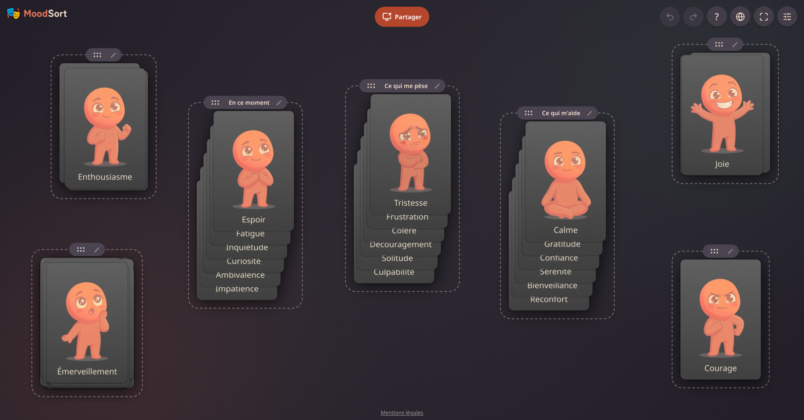

<div align="center">


# MoodSort

[](https://github.com/Semche95/MoodSort/actions/workflows/ci.yml)
[](https://github.com/Semche95/MoodSort/actions/workflows/docker-publish.yml)
[](LICENSE.txt)

**Put your feelings on the table.**

A visual emotion exploration tool: spread emotion cards on a canvas, gather them into named stacks, and see what you're feeling take shape.



</div>

## Features

- 🃏 **85 illustrated emotion cards** to drag, pile up and sort freely
- 🗂️ **Named stacks**: overlapping cards form a pile you can name, move as a block, re-gather or spread into a grid to look through it
- 🖥️ **Peer-to-peer canvas sharing**: send a link and someone sees your board live, with no signup and no account
- 🔒 **Private by design**: no backend, no tracking; your board stays in your browser
- 🌍 **Six languages**: Dutch, English, Esperanto, French, German and Spanish, auto-detected from the browser
- 🌗 **Light and dark themes**, undo/redo, fullscreen, and a board that keeps its layout across visits and window sizes

MoodSort is built for desktop and landscape tablets: below 1024px wide, the app is blocked.

## Quick start

Run the published image:

```bash
docker run -p 8080:8080 ghcr.io/semche95/moodsort:latest
```

Then open `http://localhost:8080`. `latest` tracks the most recent release; pin a version with e.g. `ghcr.io/semche95/moodsort:1.5.0`.

Or run it from source (Node.js and pnpm required):

```bash
pnpm install
pnpm dev
```

The dev server runs at `http://localhost:5170`.

## Privacy

Card positions, stack names and undo history are saved to `localStorage` only. The one exception is screen sharing: it streams the app's canvas (never the rest of the screen) directly between two browsers over WebRTC via [Trystero](https://github.com/dmotz/trystero), with no server storing or relaying the board.

Signaling relays and STUN servers can be replaced at build time with `VITE_SIGNALING_RELAYS` and `VITE_STUN_URLS` (see `.env.example` and [Signaling and STUN](docs/ARCHITECTURE.md#signaling-and-stun)).

## Built with

TypeScript, [PixiJS](https://pixijs.com) 8, Vite, Vitest, Trystero and `sharp` (card atlas and icon generation). Everything is drawn on a single canvas so a share streams exactly what the host sees.

## Documentation

- [docs/BEHAVIOR.md](docs/BEHAVIOR.md): how the app behaves and the rules it must keep
- [docs/ARCHITECTURE.md](docs/ARCHITECTURE.md): how it is built
- [CONTRIBUTING.md](CONTRIBUTING.md): development setup, commands, project structure, CI and releases

## License

[MIT](LICENSE.txt), Robin Rateau, 2026

The logo is the performing arts emoji from [Noto Emoji](https://github.com/googlefonts/noto-emoji), © Google, licensed under the [Apache License 2.0](https://www.apache.org/licenses/LICENSE-2.0).

The wordmark is drawn from [Zen Maru Gothic](https://fonts.google.com/specimen/Zen+Maru+Gothic) Black by Yoshimichi Ohira, licensed under the [SIL Open Font License 1.1](https://openfontlicense.org), converted to glyph outlines in `src/logo/title-mood.svg` and `src/logo/title-sort.svg`.
